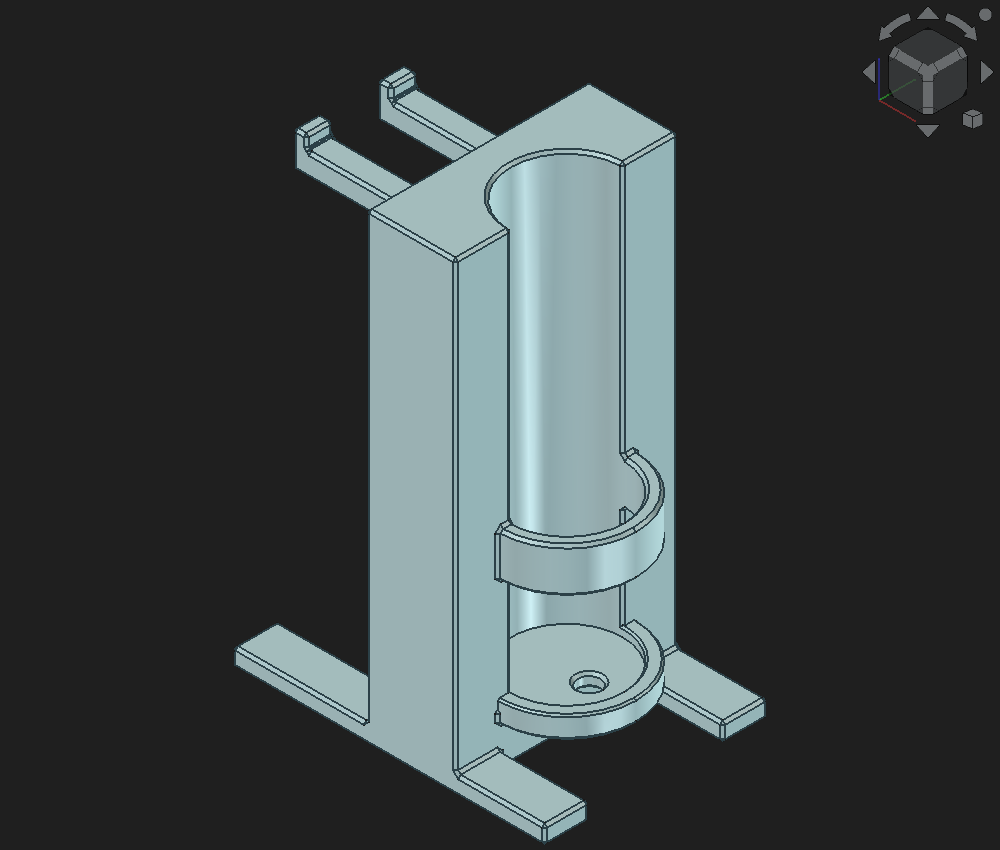

# 牙刷與刮鬍刀架

已透過 **AgentCAD MCP → FreeCAD** 建立一體式模型，最新版本 **v2**：底托保留中間單一排水孔，外緣增加 2 mm 高擋邊。



## 我要列印的檔案

**列印入口：[holder_v2_A1_PETG.3mf](print/holder_v2_A1_PETG.3mf)**。內含最新版模型、A1／PETG 設定、樹狀支撐與已完成的切片。STL 只有形狀，沒有列印參數。

## 檔案

- `models/ToothbrushShaverHolder.FCStd`：FreeCAD 工作檔。
- `print/toothbrush_shaver_holder_v2.stl`：列印網格，只有架子。
- `models/toothbrush_shaver_holder_v2.step`：可供其他 CAD 使用的實體。
- `print/holder_v2_A1_PETG.3mf`：已含列印設定與切片結果的 Bambu Studio 專案。
- `source/build_holder.py` → `source/update_tray_v2.py`：依序建立 v1、局部修改為 v2；經 MCP 在 FreeCAD 執行。

FreeCAD 內的兩個參考物件及中間形狀預設隱藏，沒有匯入 STL、STEP 或切片檔。

## 目錄用途

- `print/`：目前要印的 3MF、STL。
- `models/`：FreeCAD 工作檔與 STEP。
- `previews/`：模型視角圖片。
- `source/`：建模、切片與驗證腳本。
- `reports/`：最新版驗證結果；`slicing/` 保存本次材料、機器、製程設定與切片統計。

本機交接文件 `CONTEXT.md`、`tasks/` 工作紀錄、FreeCAD 自動備份、獨立 G-code 與暫存不提交；正式 3MF 已包含 G-code。

## 腳本執行環境

直接使用列印檔只需 Bambu Studio；重建與驗證腳本使用 Windows、Python 3.10 以上、uv，以及已啟用 AgentCAD MCP 的 FreeCAD。切片腳本另需安裝 Bambu Studio 與 A1／PETG 預設。

`source/mcp_call.py`、`source/slice_check.py` 使用預設安裝路徑；`source/build_holder.py`、`source/update_tray_v2.py`、`source/verify_holder.py` 的 `ROOT` 是原建模目錄，換位置時需改成實際專案路徑。後三支腳本透過 MCP 在 FreeCAD 內執行。建模腳本只接受空白的 `ToothbrushShaverHolder` 文件；v2 修改腳本只接受 v1，請勿直接重跑覆蓋現有 v2。

## 成品尺寸

| 項目 | 尺寸 |
|---|---|
| 外框 | 70 × 50 × 104 mm |
| H 型腳 | 兩條各 70 × 10 × 4 mm |
| 中間立柱 | 厚 20、寬 50、底架以上高 100 mm |
| 牙刷槽 | Ø25 mm，半圓嵌入立柱 12.5 mm |
| 半圓護欄 | 壁厚 3、高 10 mm |
| 護欄下方 | 到底托平面淨空 25 mm；到低擋邊頂端 23 mm |
| 底托 | 厚 3、離桌面 9 mm，只保留原本中間的 Ø5 mm 排水孔 |
| 底托擋邊 | 高 2、厚 3 mm，頂緣倒角 0.4 mm，內徑 Ø25 mm |
| 雙掛鉤 | 淨間距 13、各寬 6、厚 5、伸出 29 mm |
| 掛鉤擋邊 | 上翹 3 mm，內側可用深度 26 mm |
| 倒角 | 外露邊緣 0.6 mm，配合處保留必要淨空 |

草圖底部的 1 cm 解讀為橫腳的俯視寬度。牙刷 Ø25 是**保留空間的設計尺寸**；已實印確認，牙刷放入非常剛好。

## 已備妥的列印參數

底架平放，立柱朝上。一體印製，樹狀支撐會托住底托、護欄及兩支掛鉤。

| 設定 | 值 |
|---|---|
| 機器／噴嘴 | Bambu Lab A1／0.4 mm |
| 材料預設 | Bambu PETG Basic @BBL A1 |
| 列印板 | Textured PEI Plate |
| 層高 | 0.20 mm |
| 外牆 | 4 圈 |
| 填充 | 20% Gyroid |
| 頂／底層 | 各 5 層 |
| 支撐 | 樹狀自動，45°，允許從模型上生長 |
| 支撐頂／底間隙 | 各 0.20 mm |
| 支撐側向間隙 | 0.35 mm |
| 支撐接觸層 | 3 層，線距 0.5 mm |
| 裙邊 | 外側 5 mm |
| 噴嘴 | 245°C（沿用材料預設） |

支撐間隙是支撐與成品之間的分離空間；定義可見 [Bambu Lab 官方列印手冊](https://csm.bblcdn.com/hub/4668d0ca43994ff3bff4b37f1a65c2e7.pdf)。本案用同一種 PETG 印支撐，已用以上數值實際印出成品。

Bambu Studio **02.07.01.62** 實際切片：**520 層、58.38 g、2 小時 56 分 21 秒**。耗材與時間包含切片內的支撐和裙邊，均為估算。本次只做本機切片，沒有送出列印。

## 驗證結果

- FreeCAD `check_geometry`：1 個有效、封閉實體，無錯誤。
- 外框 70 × 50 × 104 mm，實體體積 89,611.616 mm³。
- 刀頭與牙刷空間的交疊體積皆為 0。
- 刮鬍刀抬起再向外取出的抽查位置皆無碰撞。
- 中間排水孔暢通，兩側孔已封閉，低擋邊上方保留通風空間。
- 與 v1 比較，變動僅限底托區域。
- STL：4,330 個三角面，1 個封閉網格；STEP 重新讀取有效。
- 6 個視角已人工檢視，圖片在 `previews/`。
- 切片 exit 0、無警告；讀回 G-code 確認底托、護欄、兩支掛鉤下方都有支撐。

實際執行的指令：

```powershell
uv run --script source/mcp_call.py check_geometry '{"name":"Holder"}'
uv run --script source/mcp_call.py run_code source/verify_holder.py
python source/slice_check.py
python source/verify_slice.py
```

完整數值在 `reports/validation_v2.json`、`reports/slice_v2.json`。

**已實印**：用上方的列印參數印出成品，牙刷與刮鬍刀放上去都非常剛好。

## 建模座標與尺寸依據

- X：刮鬍刀側 → 牙刷側。底架從 -30 到 40，立柱從 0 到 20。
- Y：沿立柱寬度，共 50；前後兩條腳各寬 10。
- Z：向上。底架厚 4，立柱高 100，總高 104。
- 草圖的底部「1 cm」解讀為 H 型橫腳的俯視寬度，不是板厚。
- 立柱厚 20、寬 50；牙刷槽 Ø25，圓心恰在牙刷側壁面，半圓嵌入 12.5。
- 牙刷底托厚 3，頂面 Z=12；下方離桌 9。v2 只保留原本三孔中間的 Ø5 排水孔（X=25、Y=25），封住兩側孔。
- v2 底托外緣新增高 2、厚 3 的半圓擋邊，內徑維持 25，頂緣倒角 0.4；擋邊頂部至護欄底部淨空 23。
- 半圓護欄：內徑 25、壁厚 3、高 10，Z=37 到 47；底托頂面至護欄底面淨空 25。
- 保留 Ø25 精確設計尺寸。若實物本身也是 Ø25，尚需調大間隙，不宣稱已做實物配合。
- 刮鬍刀參考：頭部 42.8 × 25.3 × 7.3，握柄 Ø11 × 83.1，總長 90.4。
- 掛鉤：兩鉤相距 13，每鉤寬 6、厚 5、突出 29，末端上翹 3；擋邊內可用深度 26，容納 25.3 深刀頭。承托高度 Z=96，握柄底端 Z=12.9。
- 外露邊緣與排水孔口做 0.6 倒角；配合處清除內倒角增加的材料，避免擠到牙刷與刀頭。
